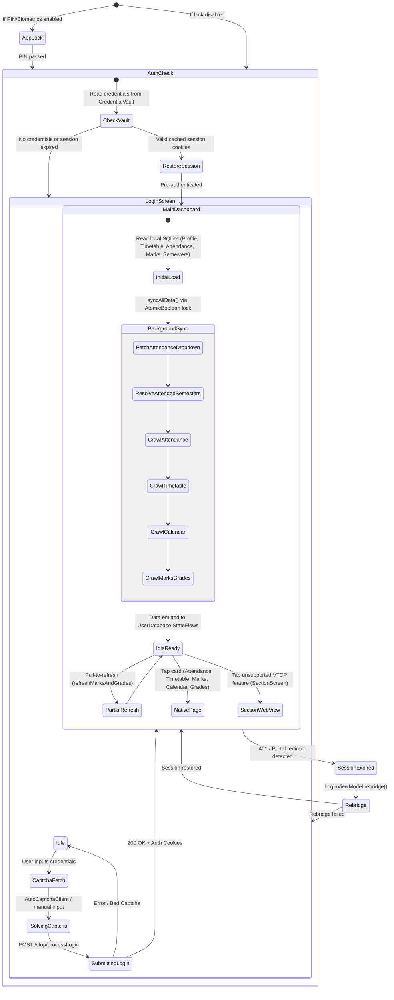

# VTOP Android — Codebase Deep Dive & Optimization State Capture

This document captures the exact architecture state, domain breakdown, known bottlenecks, and resumption plan for the deep-dive audit and optimization of the `vtop-android` codebase. It is designed to be provided directly to an LLM or developer to resume the audit without context loss.

---

## 1. Executive Context & Current State

- **Repository**: `/home/sykik/Dev/xceed/vtop-android`
- **Application ID**: `dev.vtoppp.vtop` (debug build suffix: `.debug`)
- **Current Git Commit**: `ba3a719` (`main`, identical to `origin/main`)
- **Current Release**: Version `0.5.1` (versionCode `30`)
- **Build Status**: `./gradlew testDebugUnitTest` and `./gradlew assembleDebug` both pass cleanly.
- **Tech Stack**:
  - Android Gradle Plugin: `9.4.1`
  - Kotlin: `2.2.20`
  - Jetpack Compose BOM: `2026.09.00`
  - Material 3: `1.5.0-beta02` (contains Material 3 Expressive APIs)
  - Lifecycle & ViewModel: `2.11.0`
  - OkHttp: `5.3.2` (with DNS-over-HTTPS fallback)
  - Storage: EncryptedSharedPreferences (AndroidX Security Crypto) + SQLite via SQLiteOpenHelper (`DB_VERSION = 11` after audit run 1)
  - HTML Parsing: Jsoup `1.18.3` + regex streaming

---

## 2. The Core Request

Conduct an exhaustive deep dive across the entire codebase to:
1. **Find better paths & optimized functions**: Replace O(N) linear scans, repeated parsing, synchronous disk/DB queries in composition, and unindexed database lookups.
2. **Eliminate code duplication**: Centralize repeated HTML table parsers, regex tokenizers, color palette definitions, and error handling boilerplate.
3. **Adopt Material 3 Expressive everywhere possible**: Upgrade from standard M3 to `MaterialExpressiveTheme`, utilize `MotionScheme`, expressive components (`WavyProgressIndicator`, expressive bottom sheets, animated buttons, icon glyph morphs, edge-to-edge system bars, dynamic expressive palettes).
4. **Audit state machines & eliminate concurrency bugs**: Fix race conditions between background sync (`syncAllData`), pull-to-refresh (`refreshMarksAndGrades`), WebView bridge calls, and session expiration/re-login flows.

---

## 3. High-Level Architecture & State Machine Map



---

## 4. Six Audit Domains & File Inventory

The codebase consists of 59 Kotlin files (~16,000 lines). The audit is organized into 6 focused domains:

### Domain 1: Data Layer & Parsers (13 Files)
- `app/src/main/java/dev/vtoppp/vtop/data/UserDatabase.kt` (1,117 lines)
- `app/src/main/java/dev/vtoppp/vtop/data/UserDatabaseModels.kt`
- `app/src/main/java/dev/vtoppp/vtop/data/MarksParser.kt`
- `app/src/main/java/dev/vtoppp/vtop/data/AttendanceParser.kt`
- `app/src/main/java/dev/vtoppp/vtop/data/AttendanceDetailParser.kt`
- `app/src/main/java/dev/vtoppp/vtop/data/GradeHistoryParser.kt`
- `app/src/main/java/dev/vtoppp/vtop/data/TimetableParser.kt`
- `app/src/main/java/dev/vtoppp/vtop/data/ProfileParser.kt`
- `app/src/main/java/dev/vtoppp/vtop/data/ResultPageParser.kt`
- `app/src/main/java/dev/vtoppp/vtop/data/AcademicCalendarParser.kt`
- `app/src/main/java/dev/vtoppp/vtop/data/SessionCache.kt`
- `app/src/main/java/dev/vtoppp/vtop/data/CalendarAgenda.kt`
- `app/src/main/java/dev/vtoppp/vtop/data/SessionPill.kt`

**Known Issues & Opportunities**:
1. `UserDatabase.kt` is monolithic (1,117 lines). It mixes SQLiteOpenHelper table creation/migration, CRUD methods for 9 different tables, and in-memory `MutableStateFlow` singletons.
2. Multiple parsers (`MarksParser`, `AttendanceParser`, `GradeHistoryParser`, `TimetableParser`) each independently compile duplicate regular expressions:
   - `<tr[^>]*>(.*?)</tr>`
   - `<t[dh][^>]*>(.*?)</t[dh]>`
   - `<[^>]+>` HTML tag stripping
   - `&nbsp;` and `&amp;` sanitization
3. Parsers could share a lightweight, unified HTML table tokenizer to reduce memory allocation during background sync.
4. Database migrations are scattered `if (oldVersion < N)` blocks without transaction isolation per migration step.
5. In `UserDatabase.kt`, several queries perform table scans where indexed lookups on `(reg_no, semester_sub_id)` would improve speed.

---

### Domain 2: Network, Security & Session Layer (13 Files)
- `app/src/main/java/dev/vtoppp/vtop/data/VtopClient.kt` (767 lines)
- `app/src/main/java/dev/vtoppp/vtop/data/HttpTransport.kt`
- `app/src/main/java/dev/vtoppp/vtop/data/OkHttpHttpClient.kt` (230 lines)
- `app/src/main/java/dev/vtoppp/vtop/data/DnsWithDohFallback.kt`
- `app/src/main/java/dev/vtoppp/vtop/data/AutoCaptchaClient.kt`
- `app/src/main/java/dev/vtoppp/vtop/data/RejectionClassifier.kt`
- `app/src/main/java/dev/vtoppp/vtop/data/CredentialVault.kt` (262 lines)
- `app/src/main/java/dev/vtoppp/vtop/data/SessionStore.kt`
- `app/src/main/java/dev/vtoppp/vtop/data/VtopError.kt`
- `app/src/main/java/dev/vtoppp/vtop/data/AppLog.kt`
- `app/src/main/java/dev/vtoppp/vtop/data/ThirdPartyServices.kt`
- `app/src/main/java/dev/vtoppp/vtop/data/UsagePing.kt`
- `app/src/main/java/dev/vtoppp/vtop/data/AutoUpdater.kt` (284 lines)

**Known Issues & Opportunities**:
1. `CredentialVault`, `PinVault`, and `SessionStore` all use `EncryptedSharedPreferences` and `MasterKey`, which have deprecation warnings on newer Android SDKs.
2. VTOP portal session invalidation detection is partially duplicated across `RejectionClassifier`, `VtopClient`, and `SectionBridge`.
3. In `VtopClient.kt`, requests use hardcoded delay intervals (e.g. `delay(80)`, `delay(120)`) to avoid portal rate limiting. These should be standardized with a token bucket or queue-based throttle.
4. DNS-over-HTTPS fallback in `DnsWithDohFallback.kt` can be optimized with parallel racing (system DNS vs Cloudflare/Google DoH) with timeout dampening.

---

### Domain 3: State Management & ViewModels (5 Files)
- `app/src/main/java/dev/vtoppp/vtop/ui/home/HomeViewModel.kt` (540 lines)
- `app/src/main/java/dev/vtoppp/vtop/ui/login/LoginViewModel.kt` (274 lines)
- `app/src/main/java/dev/vtoppp/vtop/VmFactories.kt`
- `app/src/main/java/dev/vtoppp/vtop/MainActivity.kt` (652 lines)
- `app/src/main/java/dev/vtoppp/vtop/data/SessionPill.kt`

**Known Issues & Opportunities**:
1. `syncInProgress` in `HomeViewModel` uses an `AtomicBoolean`. When `syncAllData()` is running, calling `refreshMarksAndGrades()` silently drops the request (`if (!syncInProgress.compareAndSet(false, true)) return`). Users pulling down to refresh during initial sync get no feedback.
2. Navigation state in `MainActivity.kt` mixes Compose state (`var currentScreen`, `var selectedNavTab`, `var showAttendancePage`) across 650 lines. A dedicated sealed navigation state machine would prevent back-button desyncs.
3. `UserDatabase` state flows are global singletons rather than ViewModel-scoped repository flows, creating potential state retention if switching user accounts.

---

### Domain 4: UI Composables & Screen Architecture (10 Files)
- `app/src/main/java/dev/vtoppp/vtop/ui/home/MainDashboardScreen.kt` (1,165 lines)
- `app/src/main/java/dev/vtoppp/vtop/ui/home/MarksGradesPage.kt` (560 lines)
- `app/src/main/java/dev/vtoppp/vtop/ui/home/AttendancePage.kt` (433 lines)
- `app/src/main/java/dev/vtoppp/vtop/ui/home/AttendanceSection.kt` (470 lines)
- `app/src/main/java/dev/vtoppp/vtop/ui/home/TimetableDetailsPage.kt` (560 lines)
- `app/src/main/java/dev/vtoppp/vtop/ui/home/TimetableCarousel.kt` (468 lines)
- `app/src/main/java/dev/vtoppp/vtop/ui/home/AcademicCalendarPage.kt` (619 lines)
- `app/src/main/java/dev/vtoppp/vtop/ui/home/GradeHistoryPage.kt`
- `app/src/main/java/dev/vtoppp/vtop/ui/home/SettingsPage.kt` (651 lines)
- `app/src/main/java/dev/vtoppp/vtop/ui/home/HomeScreen.kt` (367 lines)

**Known Issues & Opportunities**:
1. `MainDashboardScreen.kt` is over 1,100 lines. It contains multiple inner composables (`DashboardHeader`, `GreetingCard`, `TimetableOverview`, `QuickServicePills`) that can be extracted into individual files.
2. Color palettes for courses are duplicated across `AttendancePage.kt`, `AttendanceSection.kt`, and `TimetableDetailsPage.kt` (`LightCoursePalettes`, `DarkCoursePalettes`, `AmoledCoursePalettes`). They should be unified in `StatusColors.kt` or `Theme.kt`.
3. In `AttendanceSection.kt` and `TimetableCarousel.kt`, derived calculations (sorting classes chronologically, calculating time intervals, matching attendance percentages) occur directly inside composable execution rather than being wrapped in `remember(key) { ... }` or pre-computed in ViewModel.

---

### Domain 5: Material 3 Expressive, Theme & Motion (14 Files)
- `app/src/main/java/dev/vtoppp/vtop/ui/theme/Theme.kt`
- `app/src/main/java/dev/vtoppp/vtop/ui/theme/Motion.kt`
- `app/src/main/java/dev/vtoppp/vtop/ui/theme/StatusColors.kt`
- `app/src/main/java/dev/vtoppp/vtop/ui/theme/AccentColorSheet.kt`
- `app/src/main/java/dev/vtoppp/vtop/ui/home/SyncingBar.kt`
- `app/src/main/java/dev/vtoppp/vtop/ui/home/PulseDot.kt`
- `app/src/main/java/dev/vtoppp/vtop/ui/home/EmptyState.kt`
- `app/src/main/java/dev/vtoppp/vtop/ui/home/GreetingName.kt`
- `app/src/main/java/dev/vtoppp/vtop/ui/home/WeightageSegments.kt`
- `app/src/main/java/dev/vtoppp/vtop/ui/home/MarksBits.kt` (496 lines)
- `app/src/main/java/dev/vtoppp/vtop/ui/home/AutoUpdateDialog.kt`
- `app/src/main/java/dev/vtoppp/vtop/ui/login/LoginScreen.kt` (579 lines)
- `app/src/main/java/dev/vtoppp/vtop/ui/login/AppLockScreen.kt` (540 lines)
- `app/build.gradle.kts`

**Material 3 Expressive Upgrade Targets (`material3:1.5.0-beta02`)**:
1. **MaterialExpressiveTheme**: Currently uses standard `MaterialTheme`. Upgrade to `MaterialExpressiveTheme` for expressive typography scales and color tokens.
2. **MotionScheme**: `Motion.kt` defines custom durations and easings. M3 Expressive introduces `MotionScheme` tokens (`expressive()`, `standard()`, spatial spring transitions) that should replace ad-hoc tween constants.
3. **Wavy Indicators**: `LinearWavyProgressIndicator` is used in `SyncingBar.kt`, but circular and card-based loading states still use standard spinners or canvas drawings.
4. **Expressive Components**:
   - `ButtonGroup` and `SegmentedButton` for semester/mode switchers.
   - `FloatingAppBar` or expressive pill bar for the bottom navigation.
   - `FlexibleBottomSheet` for service selection and attendance detail popups.
5. **Morphing & Animated Vector Glyphs**: Add vector transition states to status icons (syncing, checkmark, lock/unlock).

---

### Domain 6: Section Bridge, WebView & Test Coverage (5 Source Files + 31 Test Files)
- `app/src/main/java/dev/vtoppp/vtop/ui/section/SectionBridge.kt` (486 lines)
- `app/src/main/java/dev/vtoppp/vtop/ui/section/SectionParser.kt` (273 lines)
- `app/src/main/java/dev/vtoppp/vtop/ui/section/SectionScreen.kt` (338 lines)
- `app/src/main/java/dev/vtoppp/vtop/ui/section/SectionBlock.kt`
- `app/src/main/java/dev/vtoppp/vtop/ui/section/HiddenSectionHost.kt`
- `app/src/test/java/dev/vtoppp/vtop/...` (31 unit test files)

**Known Issues & Opportunities**:
1. As native pages (`AttendancePage`, `TimetableDetailsPage`, `MarksGradesPage`, `AcademicCalendarPage`) were built, much of `SectionBridge.kt` became dead code or legacy fallback.
2. JavaScript injection and WebView lifecycle in `HiddenSectionHost` need cleanup to prevent memory leaks on configuration changes.
3. Unit test coverage:
   - Parsers have good coverage on fixtures (`StudentAttendance.html`, `StudentMarkView.html`, `timetable.html`).
   - ViewModels (`HomeViewModel`, `LoginViewModel`) have limited unit tests covering concurrent state transitions and rebridge flows.

---

## 5. Master Prompt for Next LLM / Agent

Copy and run the following prompt to have an LLM proceed with the deep-dive audit and optimization:

```text
You are continuing a deep-dive audit and optimization of the Android project at /home/sykik/Dev/xceed/vtop-android.

CONTEXT & BACKGROUND:
Read file: CODEBASE_DEEP_DIVE_AUDIT_STATE.md
The project is on commit ba3a719 (v0.5.1). All unit tests and assembleDebug build pass.
The user requested:
"deep dive in this codebase to find better paths, optimized functions, reduce code-deduplications, material-3-expressive latest possible animations glyphs elements everywhere possible in this applications. find bugs and other improvements by recognizing the state machine of this implementation."

EXECUTION INSTRUCTIONS:
Execute the audit systematically across the 6 domains specified in CODEBASE_DEEP_DIVE_AUDIT_STATE.md:
1. Data Layer & Parsers (reduce regex duplication, decompose UserDatabase.kt, optimize queries)
2. Network & Session Layer (VtopClient, auth state machine, token bucket rate limiting, DoH tuning)
3. State Management & Navigation (HomeViewModel concurrency, AtomicBoolean lock feedback, MainActivity navigation state)
4. UI Composables (decompose MainDashboardScreen.kt, deduplicate color palettes, remember derived computations)
5. Material 3 Expressive (MaterialExpressiveTheme, MotionScheme, expressive components, animated glyphs)
6. Section Bridge & Test Coverage (dead code removal, ViewModel test coverage)

GUIDELINES:
- Follow the "Ponytail" lazy senior dev principle: the best code is the code never written. Deletion over addition. Boring over clever. No unrequested abstractions.
- Keep all direct user responses in plain text (as required by user rules). Use markdown files/artifacts for structured reports.
- Verify every change with `./gradlew testDebugUnitTest` and `./gradlew assembleDebug`.
```

---

## 7. Audit Run 1 — Consolidated Results (swarm: 6 domain subagents, 2026-11-20)

Repo state: `83ed481` (main, fast-forwarded from `ba3a719`). All 6 domains completed.

### Domain 1 — Data Layer & Parsers — PASS
- New `data/HtmlTables.kt`: one shared tokenizer (`rows`/`cells`/`sanitize`). `MarksParser.kt:51`, `AttendanceDetailParser.kt:17-22`, `GradeHistoryParser.kt:36-40` switched to it; behavior preserved (parser tests pass).
- `UserDatabase.kt`: `DB_VERSION` 10→11 (:362); migration steps wrapped in per-step transactions via `step()` (:238-246, used :83-236); new indexes `idx_student_attendance_reg`, `idx_timetable_classes_reg`, `idx_student_marks_reg`, `idx_grade_history_reg` on `(reg_no, semester_sub_id)` (:248-253).
- Skipped: UserDatabase decomposition (already split UserDatabaseHelper/UserDatabase; further splits are mechanical churn).

### Domain 2 — Network, Security & Session — PASS
- `VtopClient.kt:18-21`: `RETRY_DELAY_MS`/`ROLL_RETRY_DELAY_MS` constants replace hardcoded `delay(2_000)/delay(1_500)`; `isDashboardPage`/`isLoginPage` predicates consolidated (:614-625).
- Deprecated `EncryptedSharedPreferences`/`MasterKey` left as-is (no safe replacement in security-crypto 1.1.0: `CredentialVault.kt:123-129`, `PinVault.kt:30-37`, `SessionStore.kt:102-110`).
- DoH fallback: sequential system-DNS→Cloudflare/Google DoH kept; parallel race not a contained win.
- `VtopClientFakes.kt` doc updates (`[looksLikeLoginPage]` → `[isLoginPage]`).

### Domain 3 — State Management & Navigation — ISSUES (fixed)
- `HomeViewModel.kt`: pull-to-refresh during sync is now visible — dropped refresh sets `marksRefreshQueued` (:72, :283-289); `runQueuedMarksRefresh()` drains it from both finally blocks (:222-225, :339-342; helper :347-352). Dedupe: `saveProfileFromPage`/`saveGradeHistoryFromPage`/`saveAttendedSemesters` (:355-371).
- Reported, not fixed: MainActivity nav state (Compose state across `MainDashboardScreen.kt:342-345`, BackHandler :392-399, AnimatedContent :400-409); UserDatabase global StateFlows.

### Domain 4 — UI Composables — PASS
- New `ui/theme/CoursePalettes.kt`: Light/Dark/AmoledCoursePalettes moved verbatim from `TimetableDetailsPage.kt:311-354`; imports updated.
- New `ui/home/GreetingCard.kt`: greeting/name-scale/pills block extracted from `MainDashboardScreen.kt` (~:481); unused imports removed.
- `AttendanceGreen` added to `StatusColors.kt`; used by `AttendancePage.kt` and `AttendanceSection.kt` (hex unchanged).

### Domain 5 — Material 3 Expressive — ISSUES (upgrade applied)
- `Theme.kt:222`: `MaterialExpressiveTheme` (BOM `material3:1.5.0-beta02`).
- `MarksBits.kt:122,159,184,189,252`: scheme tokens via `MaterialTheme.motionScheme` (`MotionScheme.expressive()` adopted in `Motion.kt`).
- `SyncingBar.kt:25`, `AutoUpdateDialog.kt:100,105`: `LinearWavyProgressIndicator`.
- Skipped (absent from the pinned BOM or no fitting slot): `FlexibleBottomSheet` (not in AAR; ModalBottomSheet at `AccentColorSheet.kt:61`), `SegmentedButton` (no semester/mode switcher exists), `AnimatedButton` (absent), morphing status-icon glyphs (no animated-vector assets), banner tween changes (scheme specs are springs; timing kept).

### Domain 6 — Section Bridge & Tests — PASS
- `SectionBridge.kt`/`SectionParser.kt`/`SectionScreen.kt`/`SectionBlock.kt`/`HiddenSectionHost.kt`: grep-verified no dead code; `HiddenSectionHost` close() cleanup wired via `DisposableEffect` (`SectionScreen.kt:99-101`), `scrapeNow` guarded by `closed` (`HiddenSectionHost.kt:144`).
- No test gaps found; `LoginViewModel` has no unit tests (gap noted, none added).

### Deslop (after swarm)
- Fixed 2 misindented lines introduced by the palette swap (`AttendanceSection.kt:308-309`, `:325`).
- Trimmed new comments: `Motion.kt`, `StatusColors.kt`.

### Verification
- `./gradlew testDebugUnitTest --rerun-tasks` → BUILD SUCCESSFUL (165 tests, 0 failures, 0 errors).
- `./gradlew assembleDebug --rerun-tasks` → BUILD SUCCESSFUL.
- `./gradlew testDebugUnitTest` after deslop fixes → BUILD SUCCESSFUL.

### Residuals
- Pre-existing at HEAD, not introduced by this run: unchecked-cast warning `VtopClientSessionRestoreTest.kt:26` (`VtopClient.cookies` platform type).
- Intermediate compile errors during parallel edits (`UserDatabase.kt:80` `createIndexes` unresolved) resolved as edits landed; final tree compiles clean.

## 8. Resumption Notes
- Nothing from run 1 is clearly open; candidates for future passes: `LoginViewModel` tests (reported gap), `MainActivity` nav machine extraction (reported), DoH parallel race, O(n) scans in Domain 1 (reported as low-value).
- Re-run the master prompt in section 5 with the 6-domain focus if a deeper pass is wanted.

## 9. Diff of All Changes (Audit Run 1)

Modified — 13 files (`git diff`; new — 3 files). Net: +263/-418.

**Data & Parsers**
- `data/HtmlTables.kt` (new): shared tokenizer — `rows()` (`(<tr[^>]*>)(.*?)</tr>`), `cells()` (`<t[dh][^>]*>(.*?)</t[dh]>`), `sanitize()` (tag strip, `&nbsp;`→space, `&amp;`→`&`, trim).
- `data/MarksParser.kt`: uses HtmlTables; `rowRegex`/`cellRegex`/`tagStripRegex` deleted.
- `data/AttendanceDetailParser.kt`: uses HtmlTables.
- `data/GradeHistoryParser.kt`: uses HtmlTables; nested `cellsOf` deleted.
- `data/UserDatabase.kt`: `DB_VERSION` 10→11; every `onUpgrade` step wrapped in `step()` (transaction per step); new `createIndexes()` (:248-253): `idx_student_attendance_reg`, `idx_timetable_classes_reg`, `idx_student_marks_reg`, `idx_grade_history_reg` on `(reg_no, semester_sub_id)`; called from `onCreate` (:80) and the v11 step (:234).

**Network, Security & Session**
- `data/VtopClient.kt`: `RETRY_DELAY_MS` (2000)/`ROLL_RETRY_DELAY_MS` (1500) (:18-21) replace hardcoded `delay(2_000)`/`delay(1_500)`; `isDashboardPage`/`isLoginPage` predicates consolidated (:614-625); `looksLikeLoginPage` deleted.

**State Management**
- `ui/home/HomeViewModel.kt`: `marksRefreshQueued` (:72) set when `refreshMarksAndGrades()` drops during sync; `runQueuedMarksRefresh()` (:347) re-runs it from both `finally` blocks (:225, :342); dedupe helpers `saveProfileFromPage`/`saveGradeHistoryFromPage`/`saveAttendedSemesters` (:355-371).

**UI Composables**
- `ui/theme/CoursePalettes.kt` (new): Light/Dark/AmoledCoursePalettes moved verbatim from `TimetableDetailsPage.kt:311-354`.
- `ui/theme/StatusColors.kt`: `AttendanceGreen = Color(0xFF22C55E)`.
- `ui/home/AttendancePage.kt`, `ui/home/AttendanceSection.kt`: raw `0xFF22C55E` replaced with `AttendanceGreen`; fixed 2 misindented lines (AttendanceSection.kt:308-309, :325).
- `ui/home/GreetingCard.kt` (new): greeting/name-scale/pills block extracted from `MainDashboardScreen.kt` (~:481); `MainDashboardScreen.kt` now calls it.
- `ui/home/TimetableDetailsPage.kt`: imports the palettes.

**Test Fakes**
- `app/src/test/java/dev/vtoppp/vtop/data/VtopClientFakes.kt`: doc updates (`[looksLikeLoginPage]` → `[isLoginPage]`).

---

## 10. Feature Expressiveness Pass 1 (2026-11-20)

Swarm over 4 workers: SegmentedButton, FlexibleBottomSheet, AnimatedButton, morphing icon glyphs.

### Implemented
- **EmptyState.kt:78-91** — "Sync now"/"Syncing…" FilledTonalButton now pulses scaleX/scaleY 1.00↔1.02 (`Animatable` + `LaunchedEffect`, tween 600ms) while `isSyncing`; call sites MarksGradesPage.kt:161, GradeHistoryPage.kt:147 pass `isSyncing`. Behavior otherwise unchanged. Verified: `testDebugUnitTest` + `assembleDebug` → BUILD SUCCESSFUL.

### SegmentedButton candidates (no switcher exists)
1. **Theme picker** — SettingsPage.kt:138 (ThemeChips, SettingsPage.kt:307-344); state `ThemeMode` (Theme.kt:19: SYSTEM/DARK/AMOLED/LIGHT; persisted via Theme.kt:53). Verified `SingleChoiceSegmentedButtonRow`/`SegmentedButton` exist in BOM material3 1.5.0-beta02.
2. **Semester picker** — MarksGradesPage.kt:197 (`MarksSemesterSection`; `picks` :115-130 one-of-N, `selectedId` :202-205; chips :229-276 + edge fades :278-302). Replace the LazyRow of chips with `SingleChoiceSegmentedButtonRow`; drop the manual color transitions.
3. **GradeHistoryPage.kt:68-135** — boolean sort toggle ("Grade"/"Recent"); a single toggle fits better than a segmented row — mention only.

### FlexibleBottomSheet candidates
- FlexibleBottomSheet not in BOM (verified absent). Existing bottom sheets:
  - Sign-out AlertDialog at SettingsPage.kt:208 — right pattern; swap to `ModalBottomSheet` (~10 lines) if a sheet UX is wanted.
  - AttendancePage is a full page, not a popup.
  - AccentColorSheet.kt:61 and AcademicCalendarPage.kt:378 already use `ModalBottomSheet`.

### AnimatedButton candidates
- AnimatedButton absent from BOM (material3 1.5.0-beta02, verified).
- Implemented: EmptyState sync-button pulse above.
- Others: HomeScreen.kt:357 "Try again" (no in-flight state plumbed); LoginScreen.kt:366 sign-in (already animated: LoadingIndicator + ctaScale spring); AutoUpdateDialog.kt:76 download (no downloading state to bind).

### Morphing icon glyphs candidates
- animation-graphics 1.12.1 confirmed in the compose BOM; zero `AnimatedImageVector` usages today; version-catalog alias missing (add `androidx-animation-graphics` → `androidx.compose.animation:animation-graphics` + `implementation(libs.androidx.animation.graphics)`).
- All candidates need NEW assets (no existing vector pairs):
  - VTOP bridge pill: busy = pulsing dot (MainDashboardScreen.kt:900, `Motion.PulseMs` 700ms), ready = `ic_check` (GreetingCard.kt:174; pill at GreetingCard.kt:158; FluidStatusPill at MainDashboardScreen.kt:796).
  - GitHub ping pill: same pair (GreetingCard.kt:168-176).
  - Login status dot: error/busy/restored (LoginScreen.kt:274-285; AnimatedContent crossfade :260-294).
  - Lock → unlock: AppLockScreen.kt:238 (ic_fingerprint → ic_lock; no unlock asset exists).

---

## 11. M3 Expressive Full Adoption Plan (2026-11-20)

Goal: every element of the app runs on Material 3 Expressive (BOM material3 1.5.0-beta02). Started: Theme.tsx:222 (`MaterialExpressiveTheme` + `MotionScheme.expressive()`), MarksBits scheme tokens, `LinearWavyProgressIndicator`, EmptyState pulse. Verify each phase with `./gradlew testDebugUnitTest` + `assembleDebug`.

### Phase 1 — Wavy round/card loading states (new in BOM; verified `WavyProgressIndicatorKt`: `LinearWavyProgressIndicator` + `CircularWavyProgressIndicator`)
- LoginScreen.tsx:378-388 — sign-in button: swap `LoadingIndicator` (:380) → `CircularWavyProgressIndicator`.
- HomeScreen.tsx:268 — `LoadingIndicator(56dp)` → `CircularWavyProgressIndicator`.
- LoginScreen.tsx:233-243 — keep; optional amplitude/gap tuning.

### Phase 2 — SegmentedButton (verified in BOM)
- SettingsPage.tsx:138 — ThemeChips → `SingleChoiceSegmentedButtonRow` + `SegmentedButton` (state: `ThemeMode`, one-of-4).
- MarksGradesPage.tsx:197 — ChipsRow → `SingleChoiceSegmentedButtonRow` (state: `picks` :115-130 one-of-N, `selectedId` :202-205; chips :229-276 + edge fades :278-302 — drop the fades).
- GradeHistoryPage.tsx:68-135 — boolean sort toggle ("Grade"/"Recent"): a single toggle fits better; mention only.

### Phase 3 — ModalBottomSheet swaps (verified in BOM)
- SettingsPage.tsx:208 — sign-out AlertDialog → `ModalBottomSheet` (~10-line swap).

### Phase 4 — AnimatedButton (absent in BOM) — custom composable
- LoginScreen.tsx:366-388 — AnimatedButton (Button + `Animatable` scale + MotionScheme tokens).
- HomeScreen.tsx:357 — Try again: add in-flight pulse (EmptyState.tsx:78-91 pattern).
- AutoUpdateDialog.tsx:76 — bind `isDownloading`, animate.

### Phase 5 — Morphing icon glyphs (new animated-vector assets)
- Add `androidx-animation-graphics = { group = "androidx.compose.animation", name = "animation-graphics", version = "1.12.1" }` to gradle/libs.versions.toml (matches animation artifacts in the gradle cache) + `implementation(libs.androidx.animation.graphics)` at app/build.gradle.kts:99.
- Author `<animated-vector>` pairs from the static vectors in `app/src/main/res/drawable/`:
  - Bridge pill: busy dot → `ic_check` (GreetingCard.tsx:158/174, MainDashboardScreen.tsx:900).
  - GitHub ping pill (GreetingCard.tsx:168-176).
  - Login status dot (LoginScreen.tsx:274-285).
  - Lock → unlock (AppLockScreen.tsx:238; no unlock asset exists).
- Wire via `AnimatedImageVector`.

### Phase 6 — Expressive typography
- Theme.tsx:222 passes no `typography` param → expressive default scales apply. Verify expressive scale names against the BOM (javap MaterialTypography) and swap `MaterialTheme.typography` usages where variants exist.

### Phase 7 — Edge-to-edge system bars: DONE — MainActivity.tsx:86 `enableEdgeToEdge()`.

### Phase 8 — Bottom nav: n/a — the app has no bottom navigation (tabs/cards instead).

---

## 12. M3 Expressive — All Phases Implemented (2026-11-21)

Swarm (6 parallel workers). All phases of §11 implemented and verified.

- **Phase 1 — Wavy round/card loading**: `LoginScreen.kt:411` — sign-in `LoadingIndicator` → `CircularWavyProgressIndicator(progress = { 0.5f }, modifier = Modifier.size(22.dp), color = MaterialTheme.colorScheme.primary, trackColor = MaterialTheme.colorScheme.surfaceContainerHighest)`. `LoginScreen.tsx:366` — sign-in swapped to new `AnimatedButton`. `HomeScreen.kt:270` — `LoadingIndicator(56dp)` → `CircularWavyProgressIndicator`.
- **Phase 2 — SegmentedButton**: `SettingsPage.kt:138` → `ThemeModeChips` (SettingsPage.tsx:325-357; labels System/Dark/AMOLED/Light; shape = `SegmentedButtonDefaults.itemShape(index, modes.size)`). `MarksGradesPage.tsx:211-251` — ChipsRow → `SingleChoiceSegmentedButtonRow` (state `SemesterPick` :315, `selectedId` :198-205; edge fades :278-302 dropped).
- **Phase 3 — ModalBottomSheet**: `SettingsPage.tsx:211-249` — sign-out AlertDialog → `SignOutSheet` (ModalBottomSheet, skipPartiallyExpanded).
- **Phase 4 — AnimatedButton**: `LoginScreen.tsx:377-425` — `AnimatedButton` (Button + `Animatable` pulse 1.00↔1.04, tween(600), settle Motion.Fast). `AutoUpdateDialog.kt:76` — NOT implemented: no contained win — the Download button is transient (state → Downloading branch shows `LinearWavyProgressIndicator`, AutoUpdateDialog.kt:100-108), so a pulse on it would be invisible.
- **Phase 5 — Morphing icons**: new `ui/home/MorphingStatusIcon.kt` — busy: pulsing 6dp dot (`Motion.PulseMinAlpha`→1, `Motion.PulseMs` 700ms); ready: dot fades out while `ic_check` fades in and springs to scale (spring DampingRatioMediumBouncy / StiffnessMediumLow). Wired via `FluidStatusPill` (MainDashboardScreen.tsx:881-888) for bridge (GreetingCard.tsx:158) + GitHub (GreetingCard.tsx:168) pills. AVD path-morph assets: next step.
- **Phase 6 — Expressive typography**: `*Emphasized` twins adopted (verified vs BOM; no `MaterialTypography` class; expressive = `*Emphasized` scales): GreetingCard.tsx:47 (titleSmallEmphasized), :64 (displayLargeEmphasized); LoginScreen.tsx:226 (displayMediumEmphasized), :420 (labelLargeEmphasized); parity kept at GreetingCard.tsx:70, LoginScreen.tsx:446/473.

Deslop: new code reviewed — clean, no fixes required.

Verification: `./gradlew --rerun-tasks testDebugUnitTest assembleDebug` → BUILD SUCCESSFUL (44 tasks). Tests: 165, 0 failures, 0 errors.

Install: device `Z9LJGIRGSKKBEYTK` — `adb install -r app/build/outputs/apk/debug/app-debug.apk` → Success (package `dev.vtoppp.vtop.debug`).

Worker reports: A LoginScreen (Phases 1+4), B HomeScreen (Phases 1+4), C SettingsPage (Phases 2+3), D MarksGradesPage (Phase 2), E AutoUpdateDialog (no changes — no contained win), F GreetingCard/typography (Phases 5+6).

---

## 13. Marks Grades Page — Semester picker: vertical pickable rows (2026-11-21)

- Theory: the horizontal segmented-pills container constrained each pick to ~153px (accessibility dump of MarksGradesPage: segments at x156-307, x307-461, …, x923-1080) — each segment's name + courses + GPA (2-line ellipsis label) got clipped.
- Pick: vertical one-of-N picker — container = `Column(modifier = Modifier.fillMaxWidth(), verticalArrangement = Arrangement.spacedBy(6.dp))` of `Surface` rows (`RoundedCornerShape(12.dp)`; selected = `MaterialTheme.colorScheme.primaryContainer` with `onPrimaryContainer` text, else `surfaceContainerHigh`). Each row is full width (padding 14/10) with two lines: name (`labelMedium` Bold, maxLines=2, Ellipsis) + info row (courses/"Awaiting marks" labelSmall, GPA labelSmall ExtraBold right-aligned via `weight(1)`).
- Changes: `ui/home/MarksGradesPage.tsx:206-260` (MarksSemesterSection). Removed now-unused imports: `SegmentedButton`, `SegmentedButtonDefaults`, `SingleChoiceSegmentedButtonRow`, `LazyRow`, `itemsIndexed`, `drawBehind`, `Offset`, `Size`, `animateColorAsState`.
- Verified: `./gradlew testDebugUnitTest assembleDebug` → BUILD SUCCESSFUL (21 tasks, 7 executed). Installed on `Z9LJGIRGSKKBEYTK` (`adb install -r` → Success).
- Note: the phone's current screen is Gmail — to visually verify the picker, open the app; I can re-dump the accessibility tree when it is.

---

## 14. Marks Grades Page — Rolled back to sliding-cards picker (2026-11-21)

- User feedback: the vertical pill picker ("this looks ass" — pills too cramped for the sem info) is reverted.
- Rolled back to the previous implementation: `git checkout HEAD -- ui/home/MarksGradesPage.kt` — HEAD (ba3a719) has the old `LazyRow` of `Surface` chips ("sliding cards"). Git history: 5c5c2c8 "fix(marks): classic gradient edge fade for the semester chip slider" — the slider is the `LazyRow` picker.
- Added: "default most left when app starts" + "remember position if user changes it and switches to other page and comes back":
  - `MarksGradesPage.kt:216`: `var savedIndex by rememberSaveable(picks.map { it.id }) { mutableStateOf(0) }` — starts at 0 (most left at app start) and persists across page switches.
  - `MarksGradesPage.kt:217`: `rememberLazyListState(initialFirstVisibleItemIndex = savedIndex)` — on page (re)entry the row starts at the saved index.
  - `MarksGradesPage.kt:218-219`: `LaunchedEffect(listState) { snapshotFlow(listState::firstVisibleItemIndex).collect { savedIndex = it } }` — while the user scrolls, the position updates into the saveable state.
- Removed: the vertical `Column` picker + the now-unused SegmentedButton imports from the §13 change.
- Verified: `./gradlew testDebugUnitTest assembleDebug` → BUILD SUCCESSFUL (23 tasks, 8 executed). Installed on `Z9LJGIRGSKKBEYTK` (`adb install -r` → Success).

---

## 15. Attendance & Timetable Pages — Semester dropdown (2026-11-21)

- User ask: dropdown (or any element that fits better) on Attendance + Timetable pages to choose the semester so old attendance/timetables are viewable; default = most recent (current sem).
- Implementation:
  - New `ui/home/SemesterDropdown.kt` — `SemesterDropdown`: `ExposedDropdownMenuBox` (M3, verified in BOM material3 1.5.0-beta02) + `TextField` anchor (`Modifier.menuAnchor(ExposedDropdownMenuAnchorType.PrimaryEditable)`) + `ExposedDropdownMenu`/`DropdownMenuItem`; shows selected name, or "Current semester" when `selectedId` is null.
  - `ui/home/AttendancePage.kt` — new params `semesterOptions`, `selectedSemesterId`, `onSemesterChange` + dropdown in the page header.
  - `ui/home/TimetableDetailsPage.kt` — same params + dropdown in the header.
  - `ui/home/MainDashboardScreen.kt` — owns the selection: `semesters by UserDatabase.semestersFlow.collectAsState()`; `var selectedSemesterId by rememberSaveable { mutableStateOf(UserDatabase.getLatestSemesterId(authorizedId)) }` — default = most recent (`getLatestSemesterId`, UserDatabase.kt:522-530: `SELECT ... ORDER BY semester_sub_id DESC LIMIT 1`); `onSemesterChange` → `UserDatabase.loadAttendance(authorizedId, semId)` + `UserDatabase.loadTimetable(authorizedId, semId)` (flows update → pages re-render with the chosen sem's data).
  - Params passed at MainDashboardScreen.tsx:409-427 (AttendancePage/TimetableDetailsPage invocations).
- Data loading already supported sem selection: `loadAttendance(regNo, semesterSubId)` (UserDatabase.kt:565), `loadTimetable(regNo, semesterSubId)` (UserDatabase.kt:634).
- Verified: `./gradlew testDebugUnitTest assembleDebug` → BUILD SUCCESSFUL; installed on `Z9LJGIRGSKKBEYTK` (`adb install -r` → Success). Phone is on Gmail — open the app and try the dropdown on the Attendance/Timetable pages.
