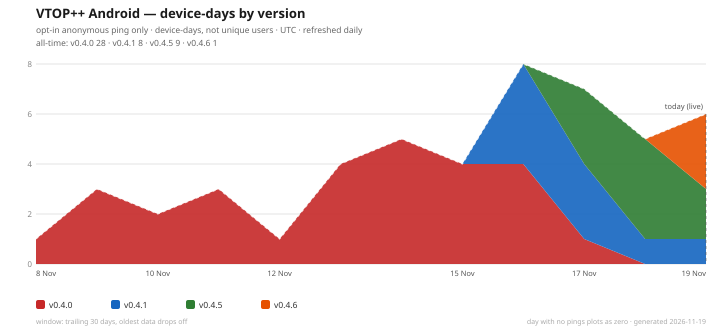

# VTOP++ Android



*Anonymous usage, trailing 30 days. Device-days per UTC day from devices with the anonymous usage ping enabled (on by default; switch off in Settings → Add-ons → Anonymous usage ping). Device-days, not unique users. Refreshes daily; details in [Anonymous usage](#anonymous-usage).*


Native Android client for the VTOP portal (VIT Bhopal). Grab the latest build from [Releases](https://github.com/vtop-xceed/vtop-android/releases).

VTOP is a desktop web portal with a captcha on every visit. This app does the boring parts for you: the captcha, the round trips, and the markup parsing, and hands you a phone-sized portal.

## What it does

- **One-tap login** — sign in once; your credentials sit in a biometric-gated vault and the captcha is solved in the background.
- **Live sessions, fast** — a secure snapshot of your session seeds the next start, so a healthy boot lands you live in seconds.
- **Honest about the network** — no signal? You get an explicit "No connection" screen with *Try again* / *Edit credentials*, not a spinner that never ends.
- **Sections at a glance** — attendance, timetable, marks and the academic calendar, parsed natively.

## Privacy

- Credentials and session cookies never leave the device. The vault is encrypted at rest and sealed behind a per-use biometric or device-credential prompt where the phone supports it.
- Logs never contain passwords or cookies.
- The anonymous usage ping is opt-out (*Settings → Add-ons → Anonymous usage ping*). Device-days, not unique users, one salted hash per device per day, no IPs or identifiers, raw rows purged after 31 days.

## Anonymous usage

The chart above refreshes daily from aggregate totals only, and contains no IPs, identifiers or per-device data. The numbers count **device-days**, one per device per UTC day, from devices that have the ping enabled — not unique users. If you want the exact payload and the roll-up job, they live in `usage/`.

## Docs

1. `docs/architecture.md` — module layout + data flow
2. `docs/vtop-session.md` — auth/session, error model, security rules
3. `docs/section-map.md` — native section parsing map

## Building

```sh
./gradlew :app:assembleDebug    # debug build; package is dev.vtoppp.vtop.debug
./gradlew testDebugUnitTest     # unit tests
```

## Contributing

PRs welcome. Read `docs/vtop-session.md` before touching auth, and keep credentials out of logs and commits. Releases are automated: bump `versionName` + `versionCode` in `app/build.gradle.kts` and merge to `main`. Maintainer-specific details live in `docs/release.md`.
